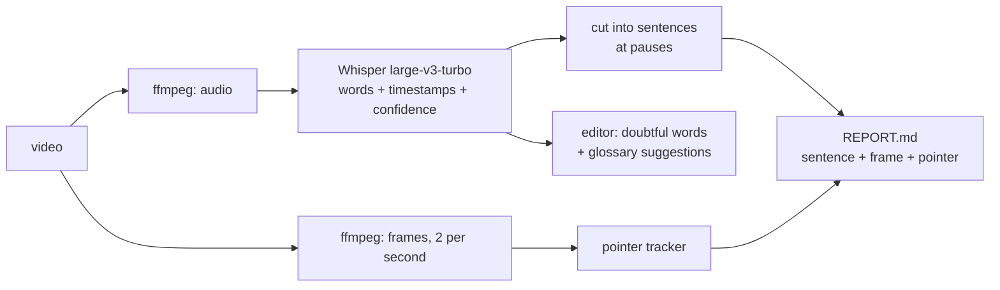

# VideoLearn

**An open-source MCP connector for Claude: give Claude ears for your screen recordings.**

> VideoLearn is an independent, open-source (MIT) project and an **MCP connector *for* Claude** (Claude Desktop, Claude Code),
> plus a small desktop app. It is not made by, affiliated with or endorsed by Anthropic.

Claude can't take video or audio as input. If you record your screen while explaining something out loud
("this is the cutting station, then the parts go *here*..."), all Claude can ever get from the file is a mouse pointer
moving around: the voice, and therefore the explanation, is lost.

VideoLearn recovers both channels and **synchronizes them**. For every sentence you said, it gives Claude the
words, the frame at that moment with **the mouse pointer circled in red**, a zoom on the pointer, and where it was
(in % of the screen). Everything runs **on your own computer**: nothing is uploaded anywhere.

<p align="center">
  
</p>

## What you get

For the [demo video](docs/demo/demo.mp4) (an invented workshop floor plan, synthetic voice), this is a real excerpt of
the report Claude receives:

```markdown
### [0:10-0:12] Then they go to the cutting station,
**Mouse**: x=39% y=25% (zone top-center) — moves from (21%,25%) to (39%,25%) while speaking
 

### [0:27-0:31] pack. Then the Calvano wrapper closes each pack at the packing area.
**Uncertain words**: pack, Calvano (→ Kelvano?)
**Mouse**: x=71% y=81% (zone bottom-right) — moves from (88%,52%) to (70%,80%) while speaking
```

<p align="center">
  
</p>

- **Speech to text** with word-level timestamps ([Whisper](https://github.com/openai/whisper) *large-v3-turbo* through
  [faster-whisper](https://github.com/SYSTRAN/faster-whisper)): ~99 languages, runs offline once the model is downloaded.
- **Mouse tracking from the finished video.** No special recorder needed: it works on any recording (phone, Teams, OBS,
  Windows Game Bar...). It finds the pointer by comparing each frame with the "page", so no cursor template is required.
- **A friendly app** (light, macOS-style, English and Italian) to process a video, replay each sentence and fix mistakes.
- **A correction editor.** Words the model was unsure of are highlighted. A **glossary** of your own jargon (machine names,
  acronyms) improves the transcription *and* flags near-misses with a suggestion (`Calvano → Kelvano?`, double-click to apply).
  Everything autosaves into `REPORT.md`.
- **A Claude connector (MCP server)** so Claude Desktop / Claude Code can call it by itself: *"Watch this video and explain
  the process."* See [Use it from Claude](#use-it-from-claude-connector).
- **Fast.** A 3-minute video takes about **25 seconds** on an NVIDIA GPU (details below).
- **Two engines, chosen automatically.** NVIDIA card: faster-whisper + CUDA. AMD or Intel card: whisper.cpp + Vulkan
  (needs the `whisper-cli` build, see [Engines](#engines)). Otherwise, or if the second engine fails: the processor.

## Install (Windows 10 / 11)

Open **PowerShell** and paste:

```powershell
irm https://raw.githubusercontent.com/sasyevadam01/videolearn/main/install.ps1 | iex
```

Or [download the ZIP](https://github.com/sasyevadam01/videolearn/archive/refs/heads/main.zip), unpack it and
double-click **`Install VideoLearn.bat`**.

The installer is per-user (no administrator rights) and takes a few minutes. It:

1. installs [`uv`](https://github.com/astral-sh/uv) (only if you don't have it), which provides a private Python 3.12 and installs the packages in seconds;
2. installs the app and the connector into `%LOCALAPPDATA%\VideoLearn`;
3. downloads `ffmpeg` (only if you don't have it);
4. **if an NVIDIA graphics card is present**, installs the CUDA libraries (~2 GB) so the GPU is used;
   **if an AMD or Intel card is present** and you pass `-WhisperCppDir <folder>` (a Vulkan build of `whisper-cli.exe`, see
   [Engines](#engines)), copies it into `%LOCALAPPDATA%\VideoLearn\whispercpp` and downloads the `ggml` model for it
   (1.6 GB, or 0.6 GB with `-VulkanModel q5`). PCs that use another engine never download it;
5. downloads the speech model once (~1.6 GB, stored in the Hugging Face cache);
6. creates **Desktop and Start-menu shortcuts**.

Disk space (measured): about 4.5 GB with the NVIDIA libraries, about 2.5 GB without (the speech model alone is ~1.5 GB).
The Vulkan engine adds about **1.7 GB** (1.6 GB model + 50 MB program) or about 0.7 GB with the quantized model. Re-run the installer at any time to update.
Options: `-NoGpu`, `-NoVulkan`, `-WhisperCppDir <folder>`, `-VulkanModel full|q5`, `-NoMcp`, `-SkipModel`, `-NoShortcuts`, `-InstallDir <path>` (run `install.ps1` directly to pass them).
To remove everything: run `uninstall.ps1` (add `-RemoveUserData` / `-RemoveModels` to also delete your glossary and the downloaded models).

> The installer is a plain, readable PowerShell script: [`install.ps1`](install.ps1). Read it before you run it, as you
> should with any script you pipe into PowerShell.

## Use it

1. Open **VideoLearn** from the Desktop.
2. Click **Choose video…** (or paste a path). A progress bar shows the steps.
3. The editor opens: click **▶** to replay a sentence, jump between doubtful words with **Next to check** (`Ctrl+Enter`),
   click a thumbnail to see the frame large.
4. Click **Copy for Claude** and paste the text into your chat with Claude, or let the [connector](#use-it-from-claude-connector) do it.

The report lives next to your video, in `<video name>_report/` (`REPORT.md`, the `segments/` images, `report.json`).

<p align="center"></p>

### Command line

```powershell
videolearn "C:\Videos\walkthrough.mp4"            # in the install folder: venv\Scripts\videolearn.exe
videolearn video.mp4 -l en -m small --glossary glossary.txt --fps 4
```

`-m small` is ~3x faster but less accurate; `--fps 4` follows the mouse more finely; `--uncertain 0.6` highlights more words.
`--engine auto|cuda|vulkan|cpu` forces an engine (default `auto`; a forced engine that cannot run is an error, `auto` falls back to the processor).
If you run the same video again, the saved transcription is reused (a few seconds instead of a full run).

## Use it from Claude (connector)

The installer puts an MCP server in `%LOCALAPPDATA%\VideoLearn\venv\Scripts\videolearn-mcp.exe`. It gives Claude three tools:

| Tool | What it does |
|---|---|
| `watch_video(video_path, language="auto", quality="precise")` | Transcribes the voice-over and tracks the pointer (progress is reported while it runs). Returns one line per sentence with the time, the words and the pointer position. |
| `read_report(report_dir)` | Re-reads a finished report without reprocessing. |
| `show_moments(report_dir, segments, view="zoom")` | Returns the actual **images** of the moments you pick (pointer circled in red), so Claude can look at what you were pointing at. |

**Claude Code**

```powershell
claude mcp add videolearn -- "%LOCALAPPDATA%\VideoLearn\venv\Scripts\videolearn-mcp.exe"
```

**Claude Desktop**: *Settings → Developer → Edit Config*, then add (use your real path, with doubled backslashes):

```json
{
  "mcpServers": {
    "videolearn": { "command": "C:\\Users\\YOU\\AppData\\Local\\VideoLearn\\venv\\Scripts\\videolearn-mcp.exe" }
  }
}
```

Then ask: *"Watch `C:\Videos\walkthrough.mp4` and explain, step by step, what the person is showing."*

Notes: the connector is a **local** tool, so it works where Claude runs on your own computer (Claude Desktop, Claude Code).
It is not a remote "web connector" for claude.ai, and the video must be on the same machine. I tested it end to end with the
official MCP Python client (tool list, progress, images, errors), and Claude Code connects to it (`claude mcp list` shows ✔ Connected).
I have **not** yet run a full conversation through Claude Desktop or Claude Code, so please tell me if something is off.

## How it works



The pointer tracker needs no template: for each frame it takes the difference from the median of the frames around it
(±20 s), keeps small blobs that contain both dark and light pixels (like a cursor), and follows the one that continues the
previous position. It handles a pointer that rests for a long time (it merges into the median and would leave a "ghost" when
it moves) and slide changes. See [`videolearn/core.py`](videolearn/core.py).

## Speed

Measured on an Intel i7-10700K (8 cores) + NVIDIA RTX 3070, for one 2 min 43 s recording (whole pipeline: transcription,
mouse tracking, report). **Your machine will differ.**

| Setup | Time |
|---|---|
| Whisper `large-v3`, CPU, 4 threads (first version) | ~221 s |
| `large-v3-turbo`, CPU, 8 threads | ~89 s |
| `large-v3-turbo`, **NVIDIA GPU (RTX 3070)** | **~25 s** |

On a sample, `large-v3-turbo` matched `large-v3` at 98% of the words (one language, one recording: don't read more into it).
Without an NVIDIA GPU everything still works on the CPU, just slower. Apple GPUs are not used.

### AMD / Intel graphics (Vulkan engine)

Measured on an AMD Ryzen 7 255 + Radeon 780M (integrated, shared memory), transcription only, `large-v3-turbo`, mean of
the runs after the first. Word times are compared with faster-whisper (b14, demo) or, for the audio with added silences,
with the known truth. **One PC, three recordings: your machine will differ.**

| Audio | faster-whisper, CPU | whisper.cpp, Vulkan | Mean word-time gap | Words within 0.5 s | Text differences |
|---|---|---|---|---|---|
| Demo, 38 s (synthetic voice, English) | 12.8 s | **6.2 s** | 0.53 s | 50% | 2 of 80 words |
| Recording, 2 min 43 s (Italian) | 36.2 s | **21.9 s** | 0.27 s | 85% | 2 extra words of 439 |
| Same + four silences of 20-30 s | 36.4 s | **27.3 s** | 0.32 s (max 2.5 s) | 83% | 0, and no word inside a silence |

So the Vulkan engine is about **1.3-2x faster** than the processor here, not 5x like an NVIDIA card, and its word times are
less exact (the pointer can be matched to a word about a third of a second off, up to ~1.5 s in the worst words; the demo is worse).
The text is nearly the same; both engines make the same jargon mistakes, which is what the glossary is for.

## Engines

| Your PC | Engine | Speech model |
|---|---|---|
| NVIDIA card + CUDA libraries | faster-whisper + CUDA | `large-v3-turbo` (CTranslate2) |
| AMD / Intel card + `whisper-cli` (Vulkan) installed | whisper.cpp + Vulkan | `ggml-large-v3-turbo` |
| anything else, or the second engine fails | faster-whisper on the CPU | `large-v3-turbo` (CTranslate2) |

`--engine auto` (CLI), `engine="auto"` (connector's `watch_video`, optional) or the app picks for you. Before using Vulkan the app runs a
2-second check and confirms that `whisper-cli` really uses the graphics card (a software renderer does not count); the result is
remembered in `%USERPROFILE%\.videolearn\vulkan_probe.json`. If the check fails, or whisper.cpp fails or takes too long, the app
continues on the CPU and writes the reason in the log. A forced `--engine vulkan` reports the error instead.

How the Vulkan engine keeps the same report: `REPORT.md`, `report.json` and the connector's tools are unchanged.
- **Doubtful words** use the same `--uncertain` threshold: a word's confidence is the mean probability of its tokens, which is
  how faster-whisper defines it (`np.mean` of the token probabilities). The two models are not calibrated identically, so counts can differ
  a little (8 vs 8 words on the 2 min 43 s recording, 1 vs 0 on the demo).
- **Word times.** whisper.cpp dates the first words after a long silence far too early, and its built-in `--vad` shifts times cumulatively.
  So VideoLearn finds the speech itself (the same Silero VAD that faster-whisper uses), splits the audio at silences of 5 s or more, has
  `whisper-cli` transcribe each piece as its own file (one process, the model is loaded once) and adds the start of the piece to every time.
  On a recording with 100 s of silence added, one single pass put 32 words inside the silences (up to 13 s off); with the split, none, and the text came out identical.

Where the files go: `<install folder>\whispercpp\whisper-cli.exe` (+ its DLLs) and `models\ggml-large-v3-turbo.bin`
(or `-q5_0`, 574 MB: a little less accurate, 0.5 GB of memory instead of 1.4 GB). `VIDEOLEARN_WHISPERCPP_DIR` overrides the folder.

**There is no ready-made Windows Vulkan build of `whisper-cli`** upstream (the official releases only have CPU, BLAS and CUDA builds).
This repository builds one: run the workflow [`build-whisper-cli-vulkan.yml`](.github/workflows/build-whisper-cli-vulkan.yml) by hand
(Actions > *Build whisper-cli (Vulkan, Windows x64)* > Run workflow, with *publish* on). It compiles whisper.cpp with MSVC and the Vulkan SDK
into one self-contained `whisper-cli.exe`, checks that it needs no extra DLLs, and publishes it as a Release asset with its SHA256. Put that SHA256 in
`$WhisperCliSha256` in `install.ps1`: from then on the installer downloads the file on AMD / Intel PCs and refuses it if the checksum differs
(the ggml models are checked against their Hugging Face SHA256 too). Until then, build it yourself once and pass the folder to the installer.
With MinGW (no administrator rights) and the Vulkan headers + `glslc`:

```powershell
git clone --depth 1 --branch v1.9.5 https://github.com/ggml-org/whisper.cpp
cd whisper.cpp
cmake -B build -G Ninja -DCMAKE_BUILD_TYPE=Release -DGGML_VULKAN=1 -DGGML_NATIVE=OFF -DWHISPER_BUILD_TESTS=OFF
cmake --build build --target whisper-cli
# put build\bin\whisper-cli.exe plus libgcc_s_seh-1, libstdc++-6, libwinpthread-1, libgomp-1 and libdl DLLs of MinGW in one folder
.\install.ps1 -WhisperCppDir C:\path\to\that\folder
```

`-DGGML_NATIVE=OFF` keeps the build runnable on other processors. The Vulkan driver itself comes with the graphics-card driver.

## Limits (please read)

- **Mouse tracking works best on mostly static screens** (floor plans, slides, dashboards, documents). When most of the
  screen changes (scrolling, video playback inside the video) the pointer may not be found; the report then says
  *"mouse not detected"*. It was tested on two recordings (a CAD floor plan and the demo here). It does **not** detect clicks.
- **Transcription is automatic.** Whisper can be confidently wrong, especially with invented names and jargon: that is what
  the glossary and the editor are for. Very long videos use a lot of memory (use `--fps 1`).
- **Needs Microsoft Edge or Chrome** to show the app window (Edge ships with Windows); otherwise it opens your default browser.
- **Windows only, for now.** The engine is plain Python and should work elsewhere (`pip install ".[mcp]"`), but the installer,
  the shortcuts and the app-window launcher are Windows-specific and untested on macOS / Linux.
- It reads the spoken language you pick (or detects it). The interface is English and Italian; report labels are English and
  Italian (other languages fall back to English).

## Privacy and security

- Transcription, mouse tracking and the app run **locally**. Downloads happen only at install time (uv, Python, packages,
  ffmpeg, NVIDIA libraries, the model from Hugging Face, and on AMD / Intel PCs the `ggml` model from Hugging Face). Once the model is cached, processing makes no network request.
- The app is a small web server bound to `127.0.0.1` only; it rejects requests with a foreign `Host` header and requires a custom
  header for every action. It exits by itself two minutes after you close its window.
- The connector reads the video path Claude asks for and writes the report next to it. Don't give it to a client you don't trust.
- Your data stays in `%USERPROFILE%\.videolearn` (glossary, recent list, error log).

## Develop

```powershell
git clone https://github.com/sasyevadam01/videolearn
cd videolearn
uv venv; uv pip install -e ".[mcp]"          # add ".[gpu]" for NVIDIA libraries
python -m unittest discover -s tests         # unit tests (no Whisper or ffmpeg needed)
python tools/make_demo.py                    # rebuilds docs/demo/demo.mp4 (Windows voice)
```

Layout: `videolearn/core.py` (pipeline), `engines.py` (whisper.cpp + Vulkan engine), `app.py` + `ui/index.html` (the app), `mcp_server.py` (connector),
`cli.py`, `prefetch.py`, `install.ps1` / `uninstall.ps1`, `tools/` (icon and demo generators), `tests/`.
Issues and pull requests are welcome.

## Credits

[faster-whisper](https://github.com/SYSTRAN/faster-whisper) and [CTranslate2](https://github.com/OpenNMT/CTranslate2),
[OpenAI Whisper](https://github.com/openai/whisper) (model), [FFmpeg](https://ffmpeg.org), [uv](https://github.com/astral-sh/uv),
[Pillow](https://python-pillow.org), [NumPy](https://numpy.org), [SciPy](https://scipy.org),
and the [Model Context Protocol](https://modelcontextprotocol.io) Python SDK.

## Disclaimer

VideoLearn is an independent, community project. It is **not affiliated with, endorsed by or sponsored by
Anthropic**. "Claude" is a trademark of Anthropic, PBC and is used here only to say which assistant the connector is for.

Previously published as *VideoLearn 4Claude*; the old repository address redirects here.

## License

[MIT](LICENSE) © 2026 sasyevadam01
